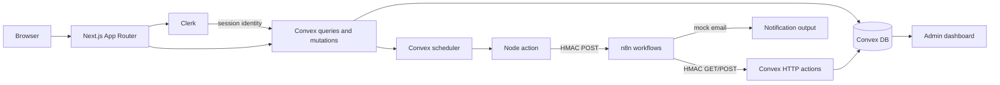

# LendLoop

**Borrow what you need. Lend what you don't.**

LendLoop is a neighborhood tool-lending board. Neighbors can list tools, request them for a date range, approve or decline requests on their own tools, and mark loans returned. A public page shows only available tools. Signed n8n workflows handle notifications and daily overdue reminders.

This is a full-stack demo built for the Fluence Full-Stack Developer application. It prioritizes server-side authorization, explicit date semantics, data minimization, and a visible audit trail.

## What it does

- Public, privacy-minimal availability board
- Clerk authentication and Convex-backed user sync
- Tool listing create, edit, and soft delete
- Borrow requests with date-range validation
- Lender approve/decline and party-only return
- Admin moderation: all loans, users, trusted lenders, listings, audit log
- Public/private status rules for current, future, and overdue loans
- Signed Convex-to-n8n notifications
- Signed n8n-to-Convex overdue reminder flow with leases and idempotency
- Error workflow that reports sanitized failures to Convex

## Stack

| Layer | Choice |
|---|---|
| UI | Next.js 16 App Router, React 19, Tailwind CSS 4 |
| Auth | Clerk |
| Backend/database | Convex |
| Automation | n8n 2.46.6, Docker Compose |
| Tests | Vitest, `convex-test` |
| Language | TypeScript |

## Architecture



The app never gives n8n direct database access. n8n receives only the fields it needs, over signed HTTP requests.

See [Architecture](docs/architecture.md) for request and reminder sequence diagrams.

## Quick start

### Prerequisites

- Node.js 20+
- npm
- A Clerk application
- A Convex account or the local Convex backend
- Docker only if you want local n8n

### 1. Install dependencies

```bash
npm install
```

### 2. Create a Clerk application

In the Clerk dashboard:

1. Create an application.
2. Enable email sign-in/sign-up for the demo.
3. Copy the publishable and secret keys.
4. Update `convex/auth.config.ts` with your Clerk issuer:

```ts
domain: "https://your-clerk-instance.clerk.accounts.dev",
applicationID: "convex",
```

### 3. Configure Next.js and Convex

```bash
cp .env.example .env.local
```

Fill in:

```env
NEXT_PUBLIC_CLERK_PUBLISHABLE_KEY=pk_test_...
CLERK_SECRET_KEY=sk_test_...
```

Start Convex in a second terminal:

```bash
npx convex dev
```

On first run, authenticate and choose/create a deployment. Convex writes the local deployment URL to `.env.local`.

Set the bootstrap admin email in Convex, not Next.js:

```bash
npx convex env set ADMIN_EMAILS you@example.com
```

### 4. Run the app

```bash
npm run dev
```

Open <http://localhost:3000>.

Sign in with the admin email. Confirm the user document exists:

```bash
npx convex data users
```

If the user was created before `ADMIN_EMAILS` was set, promote explicitly:

```bash
npx convex run users:provisionAdmin '{"email":"you@example.com"}'
```

Role changes are CLI-only. There is no client-side role management.

## Optional: local n8n automation

This is not required to use the board. It is required to see request notifications and overdue reminders.

### 1. Generate the two directional secrets

```bash
cd /home/sirsona/Code/Mctaba/Projects/lendloop

CONVEX_TO_N8N_SECRET=$(openssl rand -hex 32)
N8N_TO_CONVEX_SECRET=$(openssl rand -hex 32)

npx convex env set CONVEX_TO_N8N_SECRET "$CONVEX_TO_N8N_SECRET"
npx convex env set N8N_TO_CONVEX_SECRET "$N8N_TO_CONVEX_SECRET"
npx convex env set N8N_REQUEST_WEBHOOK_URL "http://127.0.0.1:5678/webhook/lendloop/request-notification"
```

### 2. Create `.env.n8n`

```bash
cat > .env.n8n <<EOF
N8N_ENCRYPTION_KEY=$(openssl rand -hex 32)
CONVEX_TO_N8N_SECRET=$CONVEX_TO_N8N_SECRET
N8N_TO_CONVEX_SECRET=$N8N_TO_CONVEX_SECRET
CONVEX_SITE_URL=http://host.docker.internal:3211
N8N_BLOCK_ENV_ACCESS_IN_NODE=false
GENERIC_TIMEZONE=Africa/Nairobi
EOF
chmod 600 .env.n8n
```

`.env.n8n` is ignored by git.

`CONVEX_SITE_URL` is the Convex **HTTP actions** URL. Locally it is port `3211`, while the Convex API is `3210`. The Compose file maps `host.docker.internal` so the n8n container can reach the host.

### 3. Start n8n

```bash
docker compose up -d
bash n8n/import-credentials.sh
```

Open <http://127.0.0.1:5678> and import:

```text
n8n/workflows/request-notification.json
n8n/workflows/overdue-reminders.json
n8n/workflows/error-handler.json
```

Activate the request and overdue workflows. After import, set:

```text
Workflow Settings → Error Workflow → LendLoop — Error Handler
```

The workflow JSON does not ship with a local error-workflow ID, so this step is required on a fresh n8n instance.

## Verification

```bash
npx tsc --noEmit --incremental false
TMPDIR=/dev/shm npm test
npm run lint
npm run build
```

Current status:

| Check | Result |
|---|---|
| TypeScript | Pass |
| Tests | 19/19 pass |
| Lint | 0 errors, generated-file warnings only |
| Production build | Pass |

Automation tests cover reminder claim, lease, completion, idempotency, and the returned-loan guard. See [Acceptance tests](docs/acceptance-tests.md) for the full manual matrix.

## Project structure

```text
app/
  page.tsx                 public availability
  board/page.tsx           authenticated board
  admin/page.tsx           admin moderation and audit
  sign-in/ sign-up/        Clerk routes
components/
  listing-form.tsx
  request-form.tsx
  public-tool-grid.tsx
  user-sync.tsx
convex/
  schema.ts
  users.ts
  tools.ts
  borrowRequests.ts
  admin.ts
  audit.ts
  automation.ts
  automationNode.ts
  http.ts
  lib/                     auth, dates, availability, audit
tests/
  auth.test.ts
  tools.test.ts
  borrowRequests.test.ts
  admin.test.ts
  automation.test.ts
n8n/
  workflows/
  import-credentials.sh
docs/
```

## Core rules

- Roles: `user` and `admin`. Admin status never bypasses party-only request transitions.
- Dates are date-only strings in `Africa/Nairobi`.
- The server stores half-open ranges: `[startDate, endDate)`.
- The UI asks for an inclusive return-by date; the server stores the next day as `endDate`.
- A loan is overdue when `todayInNairobi >= endDate`.
- Current/overdue unreturned loans hide the tool publicly and block new requests/approvals.
- Future reservations do not hide the tool today but block overlapping requests.
- Pending requests are a count, not a tool status.
- Removed tools cannot be approved; return/decline/cancel remain possible.
- Public tool data is limited to `_id`, name, and category.
- All permissions are enforced in Convex.

## Security and privacy

- Clerk identity is mapped to a Convex user; no client-supplied role is trusted.
- Admin queries are admin-only and the UI is not the authorization boundary.
- The public query exposes no owner, condition, description, dates, or pending count.
- Admin all-loans omits emails; the admin user directory may show email for trusted-lender administration.
- Audit rows are append-only through mutations and admin-readable.
- n8n uses two directional HMAC secrets, exact raw-body signing, five-minute timestamps, leases, and idempotency keys.
- Workflow JSON contains credential IDs, not secrets.

See [Security](docs/security.md) for the threat model and known gaps.

## Known limitations

- Notifications are **logged mocks**; replace the mock n8n node with a real email provider for production.
- n8n runs locally in Docker. The schedule only runs while the container and host are running.
- A hosted Convex deployment requires a public n8n webhook and a public Convex HTTP actions URL.
- Delivery is at-least-once. A real provider needs idempotency support for the residual retry window.
- No rate limiting, pagination, file uploads, or in-app notification center yet.
- Admin role changes and bootstrap are CLI-only by design.
- The app is a demo, not a production deployment. See [Production](docs/production.md).

## Documentation

- [Architecture](docs/architecture.md)
- [Security](docs/security.md)
- [Production readiness](docs/production.md)
- [Demo script](docs/demo.md)
- [Product spec](docs/product-spec.md)
- [Permission matrix](docs/permission-matrix.md)
- [Acceptance tests](docs/acceptance-tests.md)
- [Automation contract](docs/automation-contract.md)
- [Wireframes](docs/wireframes.md)
- [Risk register](docs/risks.md)
- [n8n setup](n8n/README.md)


