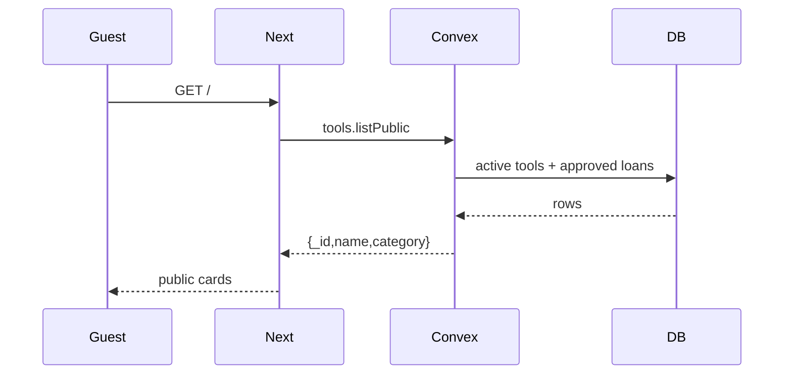
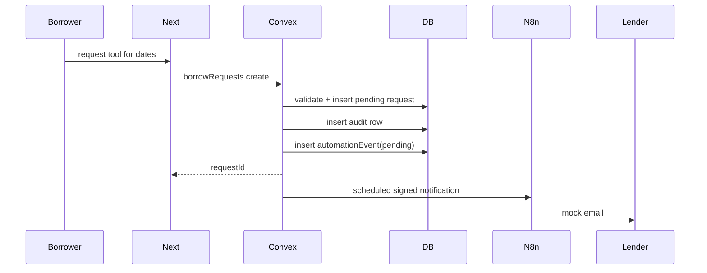
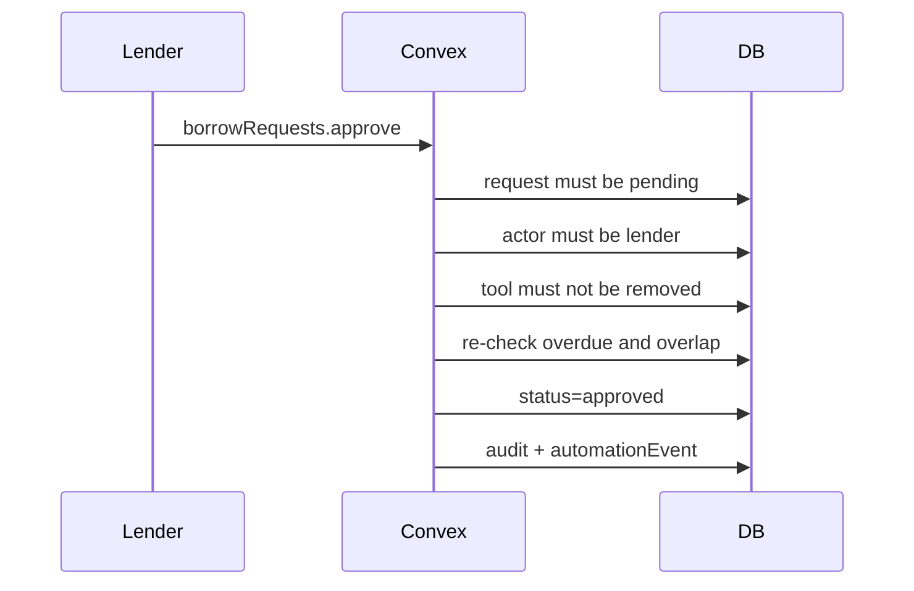
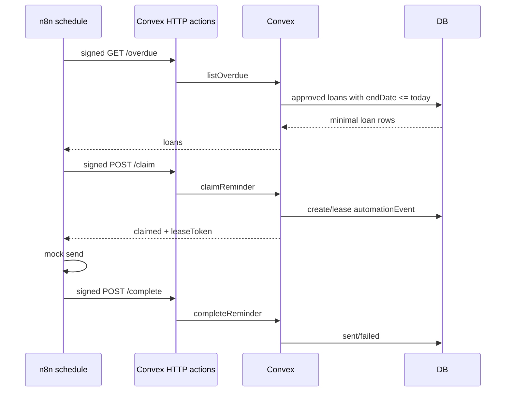

# LendLoop — Architecture

## System context

LendLoop has four trust boundaries:

```text
Browser
  │ Clerk session
  ▼
Next.js server/client
  │ Convex client
  ▼
Convex deployment
  ├── database
  ├── authorization
  ├── scheduler/actions
  └── HTTP actions
        ▲
        │ signed requests
        ▼
      n8n
```

- Clerk owns authentication.
- Convex owns data, authorization, loan rules, and the event ledger.
- n8n owns delivery workflows. It has no database access.
- Next.js owns presentation and route protection, but is not the authorization boundary.

## Read path



The public projection intentionally excludes owner, condition, description, dates, trusted status, and pending counts.

## Authenticated listing and request



The request mutation never performs network I/O. It writes the request and an automation event, then schedules a Convex Node action.

## Approval



Approval re-checks the rules because availability can change between request creation and approval.

## Overdue reminders



The claim step is what makes the reminder safe: two concurrent n8n workers cannot both own the same reminder day.

## Data model

```text
users
  tokenIdentifier, name, email, role, trustedLender

tools
  ownerId, name, category, condition, description,
  isRemoved, removedAt, removedBy

borrowRequests
  toolId, borrowerId, lenderId, startDate, endDate,
  status, message, decidedAt, returnedAt

automationEvents
  borrowRequestId, kind, status, idempotencyKey,
  eventType, attempts, leaseToken, leaseExpiresAt,
  lastError, providerMessageId

auditLogs
  actorId, action, resourceType, resourceId, metadata
```

Indexes support owner, borrower, lender, tool/status, status, idempotency, and audit lookups. There is no separate `loans` table; one request row carries the full lifecycle.

## Date semantics

```text
UI:     [ startDate ... returnBy ]   inclusive display
Server: [ startDate ... endDate )    endDate = returnBy + 1 day
Overdue: todayInNairobi >= endDate
```

This avoids off-by-one errors at the return boundary. All date comparisons use the same `Africa/Nairobi` helper.

## Failure boundaries

| Failure | Behavior |
|---|---|
| n8n unavailable | Request event fails and is visible; app data remains valid |
| Missing webhook config | Event becomes `skipped`, not retried forever |
| Reminder worker dies | Lease expires after 10 minutes |
| Concurrent reminder claims | One gets `claimed`; others get `busy` |
| Duplicate completion | Sent state is not overwritten |
| Loan returned after fetch | Claim re-check returns `not_applicable` |
| Bad signature | HTTP 401; no state change |
| Workflow error | Error workflow records sanitized `workflow_error` |
